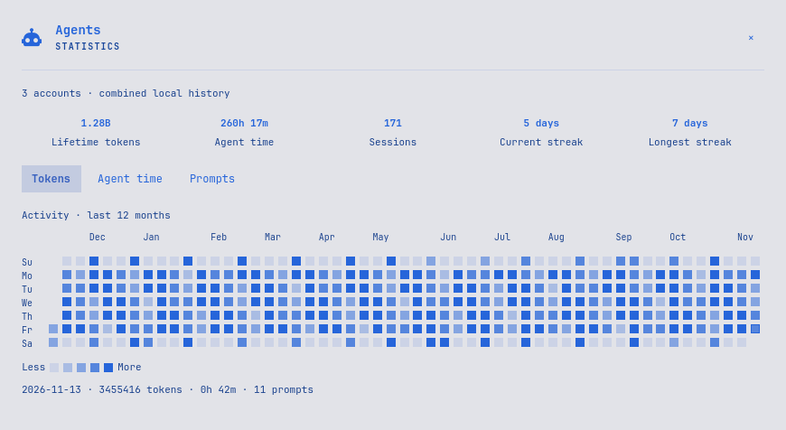

# Agents Statistics for Omarchy

The native Agents panel with a **Statistics** button: one activity calendar
and combined totals across your local Codex accounts.



The panel follows your Omarchy theme, including light and dark themes.
It refreshes automatically, shows the last saved totals immediately, and uses
the same close control and keyboard navigation as the native Agents panel.

## Requirements

- Omarchy Shell with built-in Agents, plugin cloning, `KeyboardPanel`, and
  `Commons.Translations`.
- Python 3.14 or later, including standard-library Zstandard support.
- `nice` from coreutils.

Tested on Omarchy `4.0.0.r7840.gac6cb9c-1`, built-in Agents manifest `1.0.0`.
Other Shell versions are not yet validated. No API key or third-party Python
package is needed. Node.js is used for development checks only.

## Install

```sh
omarchy plugin add https://github.com/kolotov/omarchy-agents-statistics --enable
```

Enabling this plugin replaces the built-in Agents widget in its existing
position and preserves its settings. It is a user-owned clone declared through
Omarchy's `clonedFrom` mechanism; packaged Omarchy files are untouched.
The installation command asks for confirmation before adding third-party code.

## Use

Open **Agents → Statistics**, or press **S** in the Agents panel.
Choose **Tokens**, **Agent time**, or **Prompts**, then hover over or select a
day. All locally registered Codex account homes are combined; shared history
counts once.

- **Tab** selects the close control or a display mode; **Enter** activates it.
- **Arrow keys** move through days and weeks.
- **Esc** or **×** returns to Agents. Closing the panel resets it to Agents.

Totals refresh on opening and every minute while Statistics is visible.
No statistics refresh timer runs while it is closed. A refresh already in
progress finishes and saves its result. A first scan says **Loading statistics…**;
later refreshes say **Statistics · updating…** while keeping the saved totals
visible. Refreshing manually is unnecessary; **R** remains an optional shortcut.

## What is counted

| Metric | Meaning |
| --- | --- |
| Lifetime tokens | Input, including cached input, plus output in retained local rollouts. Reasoning is already included in output. |
| Agent time | The union of recorded completed top-level turn intervals. Concurrent turns count once. |
| Sessions | Distinct user-facing threads with recorded activity. Subagent usage contributes under its parent thread. |
| Prompts | Recorded typed user prompts, excluding tool calls and internal agent prompts. |
| Streaks | Consecutive local calendar days with tokens or prompts; the current streak may end yesterday. |

The calendar covers a rolling year in local time, with Sunday first. Only
Codex rollouts are included in Statistics; the native subscription panel keeps
its other providers and account controls.

Agent time measures agent activity, including waiting within a recorded turn,
rather than personal working hours or the lifetime of an open chat. Unfinished
turns, old turns without timing, and deleted history are excluded. Token totals
are not prices, billable units, or subscription quota percentages.

## Update and remove

```sh
omarchy plugin update gkdev.agents
```

Omarchy shows the changes and asks before updating. Keep the installed checkout
clean so native updates can fast-forward.

Remove the plugin and restore the built-in Agents widget:

```sh
omarchy plugin remove gkdev.agents
```

For a temporary switch back without removing the checkout:

```sh
omarchy plugin enable omarchy.agents
```

Re-enable Statistics with `omarchy plugin enable gkdev.agents`.

## Local data and privacy

Statistics reads `sessions/` and `archived_sessions/` under `~/.codex`,
`CODEX_HOME`, and the homes in Omarchy's Codex account registry. It follows
shared directories, deduplicates identical rollout filenames across account
homes, and supports plain JSONL and Zstandard-compressed rollouts.

The statistics reader makes no network requests and reads no credential files.
The inherited Agents panel keeps its normal subscription/account behavior,
including native quota refresh and sign-in commands.

Derived state lives under
`${XDG_CACHE_HOME:-$HOME/.cache}/omarchy/agent-statistics/`: local paths,
session IDs, numeric counters, timestamps, and completed turn intervals. It
contains no transcript text. Growing logs are read incrementally after checking
file identity and boundary fingerprints. A damaged cache is rebuilt from local
history. Uninstalling the plugin leaves this derived cache and the original
agent history intact.

Omarchy plugins run unsandboxed inside Shell. Source review and testing remain
necessary; marketplace listing or automated checks are not a security audit.
The preview uses synthetic activity and contains no account or chat data.

## Development

The canonical source is [kolotov/omarchy-agents-statistics](https://github.com/kolotov/omarchy-agents-statistics).
Use a development checkout, push reviewed changes to GitHub, then update the
installed plugin through Omarchy. Local archives and the installed copy are
not alternative release sources.

See [CONTRIBUTING.md](CONTRIBUTING.md) for tests, the installed-Shell check,
preview generation, and the publication workflow. The [CI workflow](https://github.com/kolotov/omarchy-agents-statistics/actions)
runs the portable Python and JavaScript tests with Python 3.14 and Node.js 24.

Derived from [Omarchy](https://github.com/basecamp/omarchy), under the
[MIT license](LICENSE). See [UPSTREAM.md](UPSTREAM.md) for provenance and
the boundary between the inherited Agents panel and this plugin's statistics.
